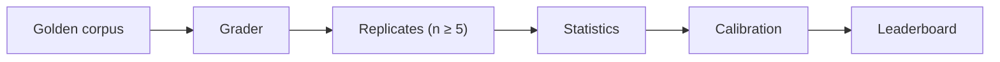

# Ground Truth

> Before you build anything, I will tell you which of your intents are safe to automate, which must route to a human, and what it costs — with a published methodology and a number you can reproduce.

An eval and regression harness for one regulated task: field extraction accuracy on pay
application and invoice documents. Every headline number is recomputable from published
per-item verdicts by a stdlib-only script that never imports this package.

![Ground Truth leaderboard page with a banner saying the data is a placeholder demo, and two demo slots whose accuracy is shown as 95% intervals (0.920 [0.870, 0.960] and 0.900 [0.840, 0.950], n=180), with list-price cost and p50/p95 latency](docs/assets/hero.png)

[](https://github.com/Berakhah/ground-truth/actions/workflows/ci.yml)
[](https://github.com/Berakhah/ground-truth/actions/workflows/nightly-smoke.yml)
[](https://github.com/Berakhah/ground-truth/releases)
[](LICENSE)

## Results

**There are no real provider results yet.** The screenshot above and the table below are the shipped
`artifacts/leaderboard.json`, which is marked `"placeholder": true`: two demo slots that show
the shape of a published row, not a measurement of any model. `scripts/reproduce.py` refuses
to "reproduce" this file for that reason.

| Slot (demo) | Accuracy, 95% CI (cluster BCa) | n | Cost / 1k items (list price) | Latency p50 / p95 |
|---|---|---|---|---|
| demo-slot-a | 0.92 [0.87, 0.96] | 180 | $1.25 | 850 / 2100 ms |
| demo-slot-b | 0.90 [0.84, 0.95] | 180 | $0.40 | 620 / 1500 ms |

When the real sweep runs ([docs/run-schedule.md](docs/run-schedule.md)), these rows are
replaced by the regenerated artifacts and the `placeholder` flag goes away.

## Quickstart

```
cp .env.example .env      # then fill in GT_PRIVATE_SEED / GT_HASH_SALT, see below
docker compose up
```

That builds the image and runs the test suite with coverage (`pytest --cov=ground_truth --cov-fail-under=75`) — the smoke test that a fresh machine's setup actually works. No other manual steps.

`GT_PUBLIC_SEED` in `.env.example` is already the real published value the shipped public corpus was built from (see `docs/methodology.md`). `GT_PRIVATE_SEED` and `GT_HASH_SALT` are placeholders you must replace with your own high-entropy values (`python -c "import secrets; print(secrets.token_hex(16))"`) — they gate the private split and are never published.

## How an evaluation runs



## Status

- **No real provider results yet:** the real provider sweep hasn't run because no provider keys are provisioned. Published views show a simulated run, labelled as such.
- **Synthetic golden set:** there is no real-invoice corpus to validate against, and external validity is unmeasured.
- **One annotator:** the rubric and the judged field's human labels come from one person, so inter- and intra-rater agreement are unmeasured.


Phase 1 has no external services: DuckDB is an embedded local `.duckdb` file (no server), and the provider gateway is shimmed — no real network calls yet.

It does not benchmark general-purpose language ability and is not a platform for arbitrary evals — see [`docs/non-goals.md`](docs/non-goals.md).

## How this was built

I designed it, wrote the specifications with Claude Code, set the evaluation criteria, directed the implementation, and reviewed and tested the changes. Claude Code generated a substantial part of the code under my direction. Counted on 7 Nov 2026: 183 of 186 commits were made through my second account, [@Berakhah-sys](https://github.com/Berakhah-sys), and 138 carry a `Co-Authored-By: Claude` trailer. All evaluation data in this repository is synthetic. The first commit originally carried a wrong date; its spec files were named 2025-09-18, yet they cite sources retrieved on 31 Aug 2026. On 4 Nov 2026 I re-dated it to one hour before the second commit (29 Aug 2026); the follow-up commit says so.

## Reproduce these numbers

Download the published `artifacts/` directory (see [Published artifacts](#published-artifacts) below), then run:

```
python scripts/reproduce.py artifacts/
```

`reproduce.py` is a standalone, stdlib-only script — it does not import `ground_truth` and needs no repository checkout. It recomputes each leaderboard row's headline accuracy directly from `verdicts_private_by_hash.jsonl` and prints published vs. recomputed side by side. Expect zero differences and exit code 0. It refuses placeholder/demo data rather than "reproducing" it.

`--require-release` additionally checks `release.json`: every file must carry the sha256 it had when the database-backed reproducibility and contamination gates passed on the machine that cut the release. The release workflow runs this, because CI never holds the results database. The attestation records that those gates ran; it does not prove it — the recomputation is what you can check yourself.

The private split's actual items are never published — only their content hashes (`manifest_private.json`), which prove the items existed at a given date without revealing them, and per-item verdicts keyed by that hash (`verdicts_private_by_hash.jsonl`), which are enough for anyone to independently recompute the headline numbers without ever seeing a private item.

## Running the harness

The two CLI entrypoints:

```
# Build the golden corpus (120 public + 180 private items) into
# golden/corpus/ and data/results.duckdb, from GT_PUBLIC_SEED /
# GT_PRIVATE_SEED / GT_HASH_SALT in .env.
docker compose run app python -m ground_truth.golden.build

# Render the print-ready triage report (expected-value automate /
# route-to-human recommendations) from an intake CSV -- see
# docs/triage-intake-template.csv for the expected columns.
docker compose run app python -m ground_truth.triage.report \
  --intake path/to/intake.csv \
  --out path/to/report.html \
  --methodology-url https://example.com/methodology
```

## Published artifacts

This is a published document with an interface, not a dashboard.

- [`docs/methodology.md`](docs/methodology.md) — how the golden set, splits, and statistics are built, and why.
- [`docs/rubric.md`](docs/rubric.md) — what counts as a correct extraction, per field type, frozen before labelling.

## Security

To report a vulnerability, see [`SECURITY.md`](SECURITY.md). For the fuller security posture —
private-split protection, secret handling, supply-chain and CI/CD controls — see
[`docs/security.md`](docs/security.md).
